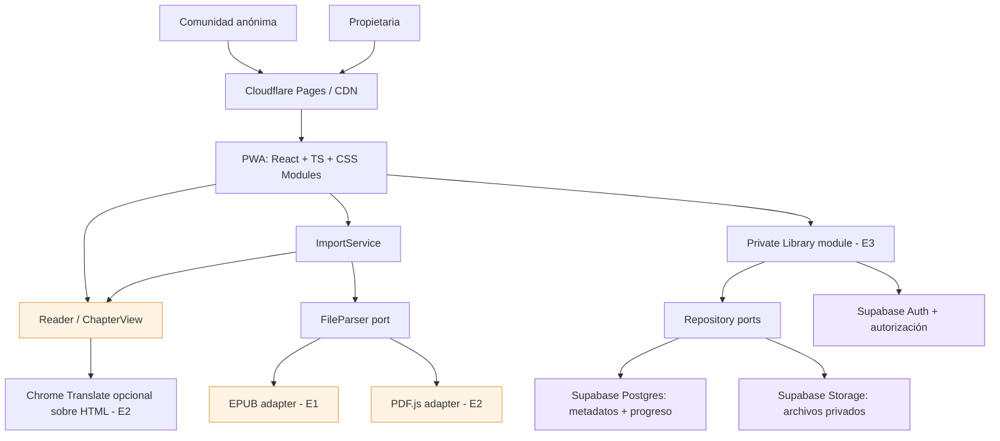

# Arquitectura técnica — Lector web inspirado en AO3

**Versión:** 1.0 — 2026-11-02  
**Estado:** arquitectura objetivo incremental, sin sobreingeniería.

## 1. Decisión arquitectónica (ADR-001)

**Elegimos:** PWA local-first, frontend estático modular con **Vite + React + TypeScript + CSS Modules**. El archivo comunitario se procesa únicamente en el navegador; la cuenta personal usa una infraestructura separada de **Supabase Auth + PostgreSQL + Storage privado**. Despliegue web en Cloudflare Pages.

**No elegimos:** Next.js con SSR, API propia permanente, microservicios, subida pública de archivos, sistema multiusuario de biblioteca, traducción de pago o base de datos para lectores anónimos.

**Motivación:** el principal trabajo (parsing + visualización) se puede realizar localmente. El costo marginal por lector es principalmente la entrega del frontend; los archivos de terceros no consumen almacenamiento remoto.

## 2. Diagrama de contenedores



**Aclaración:** `UI -> Supabase` solo ocurre en el área privada autorizada. El lector público nunca necesita cargar el SDK de Supabase; el módulo privado se importa dinámicamente.

## 3. Diseño interno: feature-based + ports/adapters ligeros

```text
src/
  app/
    App.tsx
    routes.tsx                  # cuando se requieran rutas
  domain/
    models/
      Fanfic.ts
      Chapter.ts
      ReadingProgress.ts
  features/
    importer/
      ports/FileParser.ts
      services/ImportFanfic.ts
      adapters/EpubParser.ts    # E1
      adapters/PdfParser.ts     # E2
      components/FileUploader.tsx
    reader/
      components/Reader.tsx
      components/ChapterView.tsx
      components/ChapterNav.tsx
      styles/reader.module.css
    private-library/           # E3; lazy-load
      ports/FanficRepository.ts
      ports/FileRepository.ts
      ports/ProgressRepository.ts
      services/LibraryService.ts
      components/LibraryPage.tsx
    auth/                      # E3
  infrastructure/
    supabase/                  # E3
      client.ts
      SupabaseFanficRepository.ts
      SupabaseFileRepository.ts
      SupabaseProgressRepository.ts
      SupabaseAuthAdapter.ts
    local/
      PreferencesStore.ts      # E2: solo preferencias, no obras
  shared/
    security/sanitizeHtml.ts
    ui/
supabase/
  migrations/                  # E3
```

**Regla de pragmatismo:** no generar todos estos archivos en E1. Crear abstracciones únicamente donde hay alternativas reales de tecnología o pruebas: parser, sanitización y posteriormente repositorios remotos.

## 4. Dirección de dependencias

- **Presentación:** componentes React, eventos y estado de lectura; conoce casos de uso y modelos, no consultas SQL.
- **Aplicación:** `ImportFanfic`, `LibraryService`, `SaveReadingProgress`; orquesta tareas, no sabe el SDK concreto.
- **Dominio:** modelos `Fanfic`, `Chapter`, `ReadingProgress`; sin dependencias de React/Supabase/PDF.js.
- **Infraestructura:** adapters que implementan puertos (`EpubParser`, `PdfParser`, repositorios Supabase).
- **Composición:** entrypoint conecta implementaciones concretas con servicios; la carga de módulos privados es diferida.

**Evitar:** un `SupabaseService` gigante, una clase para cada botón o abstraer todos los `useState` de React.

## 5. Contratos base

```typescript
export type SourceFormat = 'epub' | 'pdf';

export interface Chapter {
  id: string;
  order: number;
  title: string;
  html: string; // solo HTML sanitizado
}

export interface Fanfic {
  id: string;
  title: string;
  author?: string;
  sourceFormat: SourceFormat;
  chapters: Chapter[];
}

export interface FileParser {
  parse(file: File): Promise<Fanfic>;
}

// Solo se agrega en E3
export interface FanficMetadata {
  id: string;
  title: string;
  author?: string;
  format: SourceFormat;
  storagePath: string;
}

export interface FanficRepository {
  list(): Promise<FanficMetadata[]>;
  get(id: string): Promise<FanficMetadata | null>;
  save(item: FanficMetadata): Promise<void>;
  remove(id: string): Promise<void>;
}

export interface FileRepository {
  upload(id: string, file: File): Promise<string>;
  download(storagePath: string): Promise<Blob>;
  remove(storagePath: string): Promise<void>;
}
```

**Nota de rendimiento:** `Fanfic.chapters[]` es el contrato simple de E1. Si libros extensos consumen demasiada memoria, cambiar a una abstracción `ChapterSource` que cargue solo una sección por vez, sin modificar `Reader`.

## 6. Flujos de datos

**Comunidad:** `File (browser) → validación → EpubParser/PdfParser → sanitización + Fanfic → Reader`. Ningún `POST` de archivo a servidores. No persistir bytes de obra en IndexedDB, Cache API ni localStorage. La aplicación puede almacenar únicamente preferencias visuales no sensibles.

**Propietaria E3:** `Auth → LibraryService → SupabaseFanficRepository + SupabaseFileRepository → archivo autorizado descargado → ImportFanfic → mismo Reader`. Progreso: UI → debounced save local en memoria → `SupabaseProgressRepository`. Definir reconciliación por `updated_at` solo después de probar la sincronización real; evitar escrituras por cada scroll.

## 7. Modelo PostgreSQL (solo E3)

Esquema conceptual mínimo:

```sql
-- El esquema se implementará/ajustará durante E3.
create table public.fanfics (
  id uuid primary key default gen_random_uuid(),
  user_id uuid not null references auth.users(id),
  title text not null,
  author text,
  format text not null check (format in ('epub','pdf')),
  storage_path text not null,
  created_at timestamptz not null default now()
);

create table public.reading_progress (
  fanfic_id uuid primary key references public.fanfics(id) on delete cascade,
  user_id uuid not null references auth.users(id),
  chapter_index integer not null default 0,
  position jsonb not null default '{}'::jsonb,
  updated_at timestamptz not null default now()
);

create table public.user_preferences (
  user_id uuid primary key references auth.users(id),
  theme text not null default 'light',
  font_size integer not null default 18,
  language text not null default 'es'
);
```

**Invariante de datos:** `reading_progress.user_id` tiene que coincidir con el propietario de `fanfics.user_id`; se refuerza en políticas/constraints o se deriva de la relación para evitar registros inconsistentes. El DDL anterior **no es una migración de producción lista para usar**.

**Autorización efectiva:** solo un UUID de usuario propietario autorizado puede operar (valor configurado de manera segura en políticas de BD/Storage, no solo en frontend). Habilitar RLS en todas las tablas, usar políticas de owner para `SELECT`, `INSERT`, `UPDATE`, `DELETE`; en Storage, bucket privado y claves de objeto prefijadas con `auth.uid()` y validación del owner. No usar `service_role` en cliente. Probar también acceso por REST directo y reglas para alta de nuevas cuentas.

## 8. Seguridad del contenido local

- EPUB contiene HTML potencialmente hostil: usar sanitizador confiable y allowlist de etiquetas/atributos, nunca ejecutar scripts.
- Bloquear `script`, `iframe`, `form`, eventos `on*`, URLs `javascript:`; restringir enlaces y recursos remotos; aplicar CSP acorde.
- Validar tipo real/estructura y limitar tamaño comprimido y descomprimido para evitar agotamiento de memoria.
- Procesar PDF sin subirlo, en worker cuando sea viable.
- La extracción y visualización deben representar **texto HTML semántico**, no imágenes/canvas de páginas, para permitir selección y traducción.

## 9. Traducción (riesgo principal)

No se integra Google Translate mediante una API ni se intenta controlar Chrome desde JavaScript. Se renderiza HTML real y se verifica manualmente si “Traducir página” funciona al cambiar de capítulo. Si los cambios SPA rompen la traducción, valorar rutas por capítulo o navegación con recarga controlada; la solución se decide tras un spike reproducible (ver `file-format-analysis.md`).

## 10. Rendimiento, despliegue y costos

- Hosting estático en Cloudflare Pages (E4), HTTPS y CDN, sin servidor de app permanente.
- Code splitting: carga EPUB al importar EPUB, PDF.js solo en E2 al importar PDF; Supabase SDK únicamente al entrar al área privada.
- Mostrar una sección cada vez; extracción incremental para documentos grandes; límites según pruebas de memoria en celular.
- PWA E4: cachear **solo** recursos estáticos del frontend. No cachear documentos públicos, ni respuestas privadas por defecto.
- No prometer costo fijo: revisar límites y precios de Cloudflare Pages y Supabase al desplegar. Un aumento de lectores públicos no aumenta el Storage de fanfics, pero sí tráfico web/CDN.

## 11. Plan de implementación y puertas de calidad

| Entrega | Módulos activos | Gate para avanzar |
|---|---|---|
| E1 EPUB | domain, importer EpubParser, reader, sanitizer | EPUB local abre, navega, es seguro y no sube datos |
| E2 PDF/traducción | PdfParser, preferences, ajustes navegación | PDF digital legible y comportamiento Chrome documentado |
| E3 privada | auth, repositories, Supabase migrations, RLS | Archivo personal sincroniza; terceros no pueden acceder ni por API |
| E4 despliegue | PWA, CDN, tests E2E y accesibilidad | Instalación, performance, privacidad y monitorización básica |

## 12. Decisiones explícitamente aplazadas

Backend propio, multi-tenant para la comunidad, comentarios, obras públicas, recomendaciones, OCR, API de traducción, pagos, cifrado end-to-end, analítica invasiva, persistencia comunitaria y elección definitiva de límites de tamaño (requiere benchmark).

## 13. Próximas acciones sin escribir código de producción

1. Reunir EPUB y PDF de prueba sin redistribuir material de terceros.
2. Completar matriz de `file-format-analysis.md`.
3. Validar traducción de HTML semántico en Chrome Android/escritorio.
4. Dibujar 2 wireframes: inicio/importador y lector móvil/escritorio.
5. Confirmar decisiones pendientes en `requirements.md` y comenzar E1.
