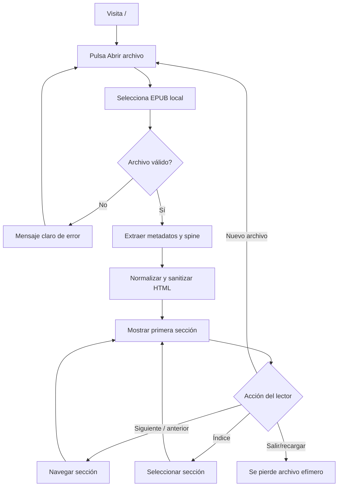
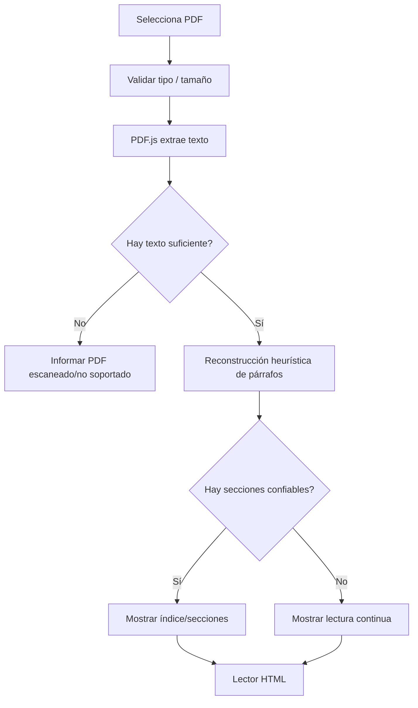
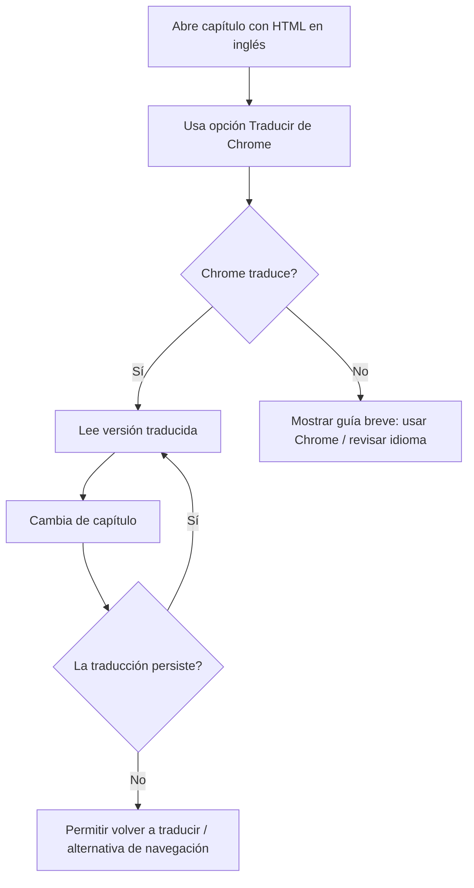
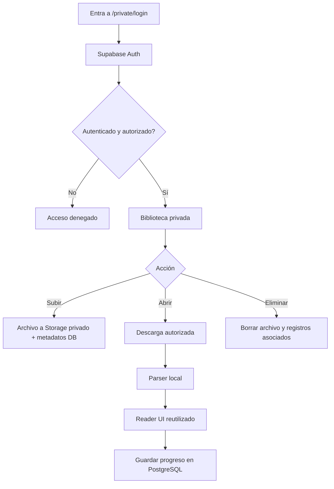

# Flujos de usuario y estados de interfaz — Lector web estilo AO3

**Versión:** 1.0 — 2026-11-02  
**Estado:** diseño de interacciones previo a E1.

## 1. Reglas generales

- La ruta pública del lector no requiere cuenta ni backend.
- El archivo seleccionado se usa en memoria del navegador; no se transmite ni se conserva después de salir/recargar.
- Las preferencias visuales pueden guardarse en `localStorage` sin guardar texto o metadatos del libro.
- La biblioteca remota aparece únicamente en modo personal, después de autenticar y verificar permisos en Supabase (E3).
- Traducción = función del navegador Chrome sobre HTML visible; la web no promete un botón propio de Google Translate.

## 2. Mapa de pantallas

| Pantalla | Identificador propuesto | Entrega | Contenido |
|---|---|---|---|
| Inicio público | `/` | E1 | CTA Abrir EPUB (ampliado a PDF en E2), mensaje de privacidad y formatos |
| Lector | `/read` o ruta por sección a validar | E1 | Metadatos, índice, capítulo actual, anterior/siguiente |
| Error / formato incompatible | Estado dentro de inicio o lector | E1 | Causa legible + volver a importar |
| Preferencias de lectura | Panel dentro de lector | E2 | Fuente, tamaño, anchura, interlineado, tema |
| Inicio de sesión personal | `/private/login` | E3 | Acceso exclusivo; nunca necesario para visitantes |
| Biblioteca personal | `/private/library` | E3 | Archivos propios, subida y apertura |
| Estado sin conexión / instalable | UI contextual | E4 | Capacidades y límites de caché |

Las URLs son propuestas; se cerrarán según la prueba de traducción.

## 3. Flujo público principal — EPUB (E1)



**Criterios:** ninguna solicitud para subir el archivo; el HTML es texto seleccionable; la navegación respeta el orden de lectura; el usuario puede volver a importar.

## 4. Flujo PDF (E2)



No habrá OCR ni promesa de reproducir el PDF original con fidelidad exacta.

## 5. Flujo de traducción (E2)



**Texto de interfaz sugerido:** “Para traducir, usa la opción ‘Traducir’ de tu navegador. La disponibilidad depende del navegador y de tu conexión”. Evitar afirmar que la aplicación traduce por sí misma.

## 6. Flujo privado (E3)



**Restricción de seguridad:** las rutas privadas ocultas no bastan. Las políticas RLS de PostgreSQL y Storage impiden acceso de cualquier otra identidad. Evitar registro público de cuentas con permiso de biblioteca.

## 7. Estados por pantalla

| Estado | Mensaje/acción | Requisito de UX |
|---|---|---|
| Inicial | “Abre un EPUB desde tu dispositivo” | CTA claro y accesible |
| Seleccionando | Selector nativo | Aceptar extensiones indicadas; validar contenido |
| Procesando | “Preparando lectura…” + progreso cuando posible | Permitir cancelar o volver |
| Listo | Metadatos y primer capítulo | Mantener scroll en inicio del capítulo |
| Sin capítulos detectados | “Lectura continua” | No bloquear apertura |
| Archivo corrupto | “No pudimos abrir este archivo” | Mensaje breve, opción reintentar |
| PDF escaneado | “Este PDF no contiene texto extraíble” | Aclarar que OCR no está disponible |
| Tamaño excesivo | “Este archivo supera el límite recomendado” | Nunca congelar navegador indefinidamente |
| Traducción no disponible | “Usa la función Traducir del navegador” | No impedir lectura original |
| Servicio privado caído | “La biblioteca no está disponible” | No afectar al lector público |
| Sin permiso privado | “Acceso no autorizado” | No revelar datos privados |

## 8. Historias de usuario y aceptación

### HU-01 — Importar EPUB sin cuenta (E1)
**Como** lector anónimo, **quiero** elegir mi EPUB, **para** leerlo con formato cómodo.

**Dado** un EPUB válido, **cuando** lo selecciono, **entonces** veo su contenido sin que se envíe a un servidor.  
**Dado** un EPUB incorrecto, **cuando** lo selecciono, **entonces** recibo un mensaje y puedo probar otro.

### HU-02 — Navegar capítulos (E1)
**Como** lector, **quiero** un índice y botones anterior/siguiente, **para** recorrer el fanfic.

**Dado** un EPUB con varias secciones en spine, **cuando** cambio de capítulo, **entonces** veo la sección correspondiente y mantengo intacto el archivo en memoria.

### HU-03 — Leer PDF textual (E2)
**Como** lector, **quiero** importar un PDF digital, **para** leer su texto en formato adaptable.

**Dado** un PDF con texto, **cuando** se procesa, **entonces** veo HTML legible.  
**Dado** un PDF escaneado, **cuando** se procesa, **entonces** veo una limitación clara y puedo regresar.

### HU-04 — Traducir desde Chrome (E2)
**Como** lector, **quiero** usar la función de traducir página, **para** leer en español sin API de pago.

**Dado** contenido visible como HTML, **cuando** Chrome lo soporta y activo traducir, **entonces** el texto se traduce. Se verifica qué pasa al cambiar de capítulo; no se garantiza en cualquier navegador.

### HU-05 — Biblioteca exclusiva (E3)
**Como** propietaria, **quiero** guardar mis archivos en la nube, **para** acceder desde varios dispositivos.

**Dada** una cuenta no autorizada, **cuando** intenta acceder a DB o Storage, **entonces** recibe denegación tanto desde UI como en llamadas directas a API.

## 9. Wireframes textuales

**Inicio:**
```text
[Nombre del lector]                              [Ayuda]

           Tu lectura, con la familiaridad de AO3
          [ Abrir EPUB ]  (PDF desde E2)
   Los archivos públicos se procesan solo en tu dispositivo.
```

**Lector:**
```text
[← Inicio]             [Índice ▾]            [Opciones]

                    TÍTULO DEL FANFIC
                       Autor (opcional)
                       Capítulo 1

       Texto legible con párrafos, énfasis y scroll.
       No canvas ni capturas de páginas.

              [← Anterior]  [Siguiente →]
```

## 10. Pruebas manuales esenciales

- [ ] Móvil Android: abrir EPUB, scroll, menú índice, siguiente/anterior.
- [ ] Escritorio: drag/drop opcional, importación vía selector, teclado y zoom.
- [ ] DevTools/Network: no se transmiten bytes del EPUB/PDF a backend.
- [ ] Recarga: los visitantes no conservan el documento.
- [ ] Archivo corrupto: error recuperable.
- [ ] XSS de laboratorio embebido en EPUB: no ejecuta scripts ni carga URLs externas inesperadas.
- [ ] Chrome Android/escritorio: traducción inicial y tras cambio de capítulo (E2).
- [ ] Acceso privado sin login o con usuario no autorizado: 403/denegación efectiva (E3).
